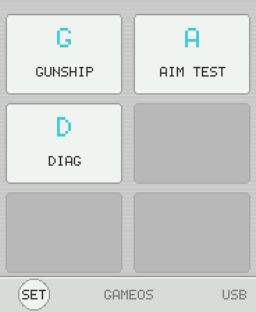
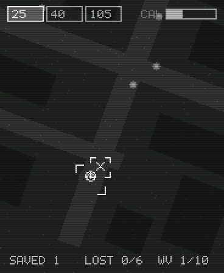
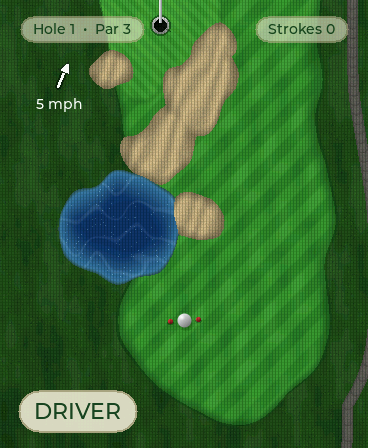
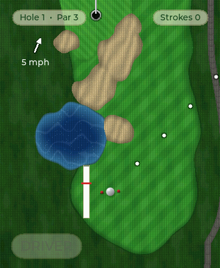

# gameos

A handheld game OS — and a growing set of games — for the
**Waveshare ESP32-S3-Touch-AMOLED-1.8** (368x448 AMOLED, touch, IMU,
speaker, 8 MB PSRAM). Plain C on ESP-IDF; no game engine, no LVGL in the
frame path, no sprite/PCM asset files. Everything you see and hear is
procedural.

| Launcher | Gunship | Golf | Golf: aiming |
|---|---|---|---|
|  |  |  |  |

*(Frames rendered by the host simulator — pixel-identical to the device.)*

## The games

- **GUNSHIP** — AC-130 thermal gunner over a dead town. Tilt to aim,
  time-of-flight shells against an orbiting camera, 10 waves, upgrades.
  Indexed-palette thermal rendering with scanlines and sensor noise.
- **GOLF** — a full port of the standalone Infinite Golf: procedural
  SDF-generated courses, three clubs, wind, swing-by-actually-swinging-the-
  device (IMU stroke integration), 18-hole rounds, pass-and-play for 2-4,
  leaderboard. Full-res RGB565 with real Montserrat type.
- **SLOTS** — a palette-trickery slot machine with a physical pull gesture.
- **DIAG / AIM TEST** — built-in hardware diagnostics and the tilt-aim
  latency test harness.

## Architecture

```
games → contract (gos.h) → shell → core → HAL      (dependencies point down)
```

- A game includes **only `gos.h`** and registers one struct: id, capability
  flags, a state size, and five function pointers (init/update/render/
  suspend/teardown). Adding a game = one registry line + a component.
- All games compile into the single firmware image and execute in place
  from flash. "Launching" a game is a `calloc` of its declared state
  (internal SRAM, PSRAM fallback for the multi-megabyte ones) — which is
  why launches are instant and the OS never reboots between games.
- Two render paths: a 184x224 indexed-8 pipeline (palette LUT applied
  during a 2x DMA upscale — gunship's thermal look is mostly palette
  animation) and a full-res 368x448 RGB565 direct mode with a Montserrat
  text service rendered straight from LVGL font data (golf).
- Fixed 1/60 game loop; a flush task overlaps palette/upscale work with
  panel DMA in ping-pong bands. 60.0 fps measured on all games.
- 8-voice chip synth (22 kHz mono) — every sound is a note table.
- Input: IMU tilt aim with one-euro filtering (three aim modes), a raw
  200 Hz accelerometer stream for gesture detectors (golf's swing, slots'
  pull), single-point touch with hard-won parallax compensation, and the
  BOOT button delivered to games as a real control.

```
main/                  boot + service init
components/
  gos_hal/             display, touch, IMU fusion, audio, power, button
  gos_core/            gfx, fonts, input, mixer, save, rng, grid, loop
  gos_shell/           launcher, settings, pause overlay, calibration, registry
  games/               gunship, golf, slots (+ diag/aimtest in shell)
docs/                  the platform book: hardware traps, game contract,
                       rendering, input/UX rules, audio, verification,
                       design playbook
```

**Building a game for this device? Start with [`docs/README.md`](docs/README.md).**
The docs are the distilled cost of every mistake made here: the QSPI panel
wants 80 MHz or it caps at 54 fps, the touch panel registers presses 15-25 px
below your finger, the PMIC lies about battery when no pack is fitted, gyro
axis signs are learned online because mounting guesses invert them, and a
dozen more.

## Build & flash

Requires ESP-IDF v6.x. Dependencies (LVGL, Espressif drivers, the Waveshare
BSP) are fetched automatically by the IDF component manager on first build.

```sh
. $IDF_PATH/export.sh
idf.py build
idf.py -p /dev/cu.usbmodemXXXX flash    # port may re-enumerate after flashing
```

## Verification without hardware

Every game ships with `#ifdef GOS_HOST_SIM` hooks: the real game sources
compile on a desktop against ~50 lines of stub services, driven by scripted
input, dumping pixel-exact PPM frames. The rule here is that sims must
*instrument a claim* — "the first zombie is on screen within a second of
mission start", "a released shot lands where the preview predicted",
"an 18-hole round completes through the leaderboard save" — not just
render pretty frames. See
[`docs/testing-and-verification.md`](docs/testing-and-verification.md).

## License

MIT — see [LICENSE](LICENSE). Bundled component dependencies (LVGL, ESP-IDF
components, the Waveshare BSP) carry their own licenses and are pulled at
build time rather than vendored here.
