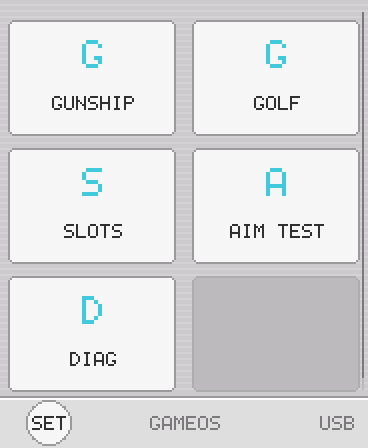

# Input & UX

This is the most bug-dense area of the platform. Every rule below traces to a
user-reported failure ("menus do nothing", "it launches gunship by default",
"QUIT does nothing"). Follow them exactly.

## Touch parallax — the #1 trap

**Measured on this panel: finger contact registers 15–25 px below the aimed
target** (render space). Serial traces showed seven consecutive QUIT presses
landing at y=170–182 against a zone ending at y=167. Independently, golf's
title screen needed a 30 px "low thumbs" allowance.

Compensation rules (the shell already does all of this — copy it):

1. Bias the touch point up by `TOUCH_Y_BIAS = 12` before hit-testing
   (`shell.c:78`).
2. **Extend every touch zone ~20 px below its visual.**
3. **Never ship a touch row shorter than ~40 px** (render space). A ≤26 px row
   is unusable on this device. The shell's overlay buttons are 40 px apart
   with 44-tall zones.
4. Overlapping zones: test top-down, first match wins, `return` after a hit.

## Tap semantics

- **UI actions fire on edges** (`pressed`/`released`), never on held state.
- Menus: fire on press-edge OR release-tap, with a `press_consumed` guard so
  one contact = one action.
- **Launching/destructive actions: release-only.** A press-edge launcher fired
  on the very first boot contact ("it launches gunship by default").
- Swipes re-arm only after a full no-touch frame.
- The touch panel flickers during holds: hold-to-X timers must tolerate brief
  release gaps (golf accumulates across flickers with a release-age
  continuation, and allows <16 px of jitter from the press origin).
- A missed release edge makes the next press read as a held continuation —
  design state machines to recover from that.

## Screen safe zone

The rounded panel corners eat ~6 render px (12 physical) per edge.
**Keep all UI inside `SAFE = 6`** (`shell.c:151`): HUD chips at x≥6, bars
ending ≤178, bottom text at H−14. In FB565 mode the margin is 12 panel px.

## Escape routes — non-negotiable

**Never ship a screen without a way out.** The OS guarantees:

- Swipe down from the top edge (press y<14, drag >40) → pause overlay, in any
  game.
- BOOT is a GAME button: delivered to the running game as `GOS_BTN_A` press/release edges. A 600 ms hold toggles the debug overlay (dev-only; the game sees the press-edge but never the release). On the pause overlay a short press resumes. Pause = swipe down from the top edge, only.

Games must additionally:

- Draw an explicit EXIT affordance on terminal screens (briefing, win, lose).
  Gunship uses a "< EXIT" chip (zone y<26, x<56) plus a "SWIPE DOWN FROM TOP
  = MENU" hint on the brief.
- Wire EXIT to `gos_request_exit()` — never try to draw the launcher yourself.

## Aim modes (tilt games)

Three modes, user-selectable in OS settings — games read the abstraction and
must work in all three:

- `GOS_AIM_TILT_ABS` (default): 25° tilt range, pow-1.4 response curve,
  deadzone 0.04, one-euro filtered. Tuned via the AIM TEST harness
  (pass bar: 30-trial median time-to-acquire < 1.2 s).
- `GOS_AIM_GYRO_RATE`: rate control, gain 0.04.
- `GOS_AIM_TOUCH_DRAG`: for users who don't want tilt.

Tips:

- Provide an in-game **recenter** affordance for tilt play (gunship: tap the
  CAL zone in the top strip, x 100..140, flashes white 0.5 s as feedback).
  There is no two-finger gesture — touch is single-point.
- Recenter must be **tap-edge only**. A per-frame recenter captured the user's
  mid-reach hand pose whenever they reached for another control.
- Leave a dead gap (~10 px) between adjacent top-strip controls so a reach
  for one can't trigger its neighbor.
- Yaw does not exist. Design aiming around pitch/roll only.

## TILT SETUP: the sensor is not mounted the same way on every unit

**Measured 2026-08-19 on two ESP32-S3-Touch-AMOLED-1.8 boards, and again
2026-10-21 on a third with a virgin NVS: held as played, gravity lands on accel
+X, and dropping the LEFT edge drives accel Y positive.** The mapping the
platform shipped with reads roll from `+Y`, so on all three units left/right
aim came out backwards.

That makes it a **wrong default, not per-unit variance** — three for three is a
board fact, and the fix is the sign in the default map. It had hidden because
`INVERT X` does cancel it (it negates `aim_x` alone), so an owner who flipped
that row once had a correct-aiming unit forever and never saw the bug again.
`RECALIBRATE AIM` does not help: it only moves the center.

The accel→pitch/roll map (which axis feeds which angle, plus a sign each) is
nonetheless runtime data rather than a constant. It lives in settings next to
the other tilt rows and is pushed into the IMU task by `gos_settings_apply()`.
**The default is the measured-correct mapping** (`pitch<-+ax`, `roll<--ay`), so
a stock board aims correctly out of the box and nobody has to open the wizard.
The wizard is kept for the unit that genuinely is mounted differently — if a
future board revision moves the part, it is already handled.

Upgrading from a v1 settings blob migrates the other fields but deliberately
**drops a stored `INVERT X`**: under v1 that toggle was the only way to correct
the hardware, so an ON there meant "compensated by hand", and carrying it onto
the corrected default would invert aim right back.

*Host-sim capture: the real `shell.c` under a scripted gravity vector.*

The **TILT SETUP** row (TILT GAMES section) runs a three-step wizard:

1. "HOLD THE DEVICE HOW YOU PLAY": tap captures the raw gravity vector.
2. "TILT TO AIM UP": the axis that rotates ≥15° from that neutral, held ≥1 s,
   becomes pitch.
3. "TILT TO AIM LEFT": same detection on the remaining axis, sets the roll
   sign. A gesture landing on the pitch axis again is rejected with "TRY AGAIN"
   instead of being recorded. Step 3 starts watching only once the device is
   back near neutral, so unwinding step 2's own tilt is never read as an answer
   (it used to trip that rejection on the way back).

**The gesture defines the semantics.** The prompts name an outcome, never a
motion: whatever the user does to aim up becomes aim up on their unit. That is
why the animation's arrows are double-headed, and why the hint reads "ANY WAY
YOU LIKE, THEN HOLD". Each prompt names the gesture that must read **negative**
(aim up = negative pitch, aim left = negative roll), so the recorded sign is
the negation of the measured delta.

**Detect in angle space, never in raw g.** Held as played the screen is near
vertical, so the screen-vertical channel already reads ~0.9 g: rocking further
that way moves it ~0.06 g while rocking back moves it half a g. A raw-g
threshold is reachable in one direction only, and the first build shipped that
bug (the wizard saw one direction and ignored the other). `asin` of the same
channel does not saturate: those 0.06 g are a clean 10°. The two axis angles
are exactly decoupled too, since rotating about one body axis leaves the other
channel untouched.

Rules it obeys, all of them from this file: no axis letter or sign ever reaches
the screen, a held gesture shows a progress bar so "sustained" is visible, the
device animation is indexed primitives on the GRAY64 ramp with no assets, and
the swipe-down-from-top escape leaves the wizard with the stored map untouched.
Each step transition logs one INFO line under `shell`, which is how a wizard
run gets verified without watching the panel.

RECALIBRATE AIM is unchanged and still the fast path: neutral only, no wizard.

## `GOS_CAP_TOUCH_FIRE` layout implications

With this cap, any touch in the **lower 2/3** sets `GOS_BTN_FIRE`. So:

- The top 1/3 is your UI strip (chips, EXIT, CAL) — but those touches never
  set FIRE, so top-strip UI needs its own touch-edge handling.
- Don't put tappable UI in the lower 2/3 of an action game; a tap there fires
  the weapon. If you must (upgrade rows), bias zones and expect FIRE noise.

## Settings the OS owns (don't duplicate them)

Volume, brightness, aim mode/sensitivity/invert, and calibration all live in
the OS settings screen. A game options page should link the concept
("sound is in OS settings") rather than grow its own row — golf ships exactly
that note. Grouped tilt settings are labeled "TILT GAMES" in the shell so
they don't read as one game's leftovers.

## Visual language of the shell (for coherence, not conformity)

The launcher is a Wii-menu look: light striped field, white rounded cards,
bottom bar with a round SET button, battery on the right. Games are free to
have their own art direction, but system-ish screens inside a game (pause
text, confirmations) read best in the same calm register: generous spacing,
40 px rows, no drop shadows over dim backgrounds (they read as black borders).

## Text legibility

- Indexed mode fonts are 5x7 and 10x14 — ALL-CAPS short labels only.
- Anything sentence-length needs FB565 + Montserrat (`gos_gfx_text565`).
- Type ladder that worked in golf: headline 28 / primary 22 / meta 18 /
  hint 14.
